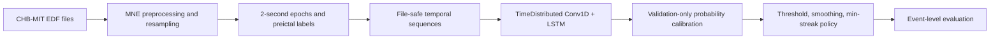

# Seizure Prediction BCI — CHB-MIT Pilot

A rare-event EEG research pipeline that turns CHB-MIT EDF files into file-safe temporal sequences, calibrates preictal probabilities, and evaluates alarm policies at the event level.

## Results and status

The checked-in code and project journal describe a **CHB01 pilot**. They emphasize why high accuracy can hide a detector that misses nearly every seizure; the repository does not include a stable, independently reproducible headline result/checkpoint in this checkout. No clinical or real-time capability is claimed.

**Status discrepancy:** the supplied desktop context labels this project “Phase 4,” while the public README and journal describe Phase 1 and list later phases as planned. This draft reports the scope established by the code and flags the discrepancy instead of asserting which tracker is current.

## Architecture



## Quickstart and verification

The repository's setup requires CHB01 data at `data/chb01/`, including its summary file. Those inputs are not bundled, and the pipeline was not run in this review.

```bash
python3 -m venv .venv
source .venv/bin/activate
pip install -r requirements.txt
```

Download CHB01 from PhysioNet under its access terms, place the files in the expected directory, then run:

```bash
python src/lstm_model_pipeline.py
```

Verify this setup in a clean environment before treating it as a validated quickstart.

## Limitations

- Current evidence is a single-patient/small-seizure pilot; event metrics are noisy at low event counts.
- Multi-patient generalization and prospective headset operation are not demonstrated.
- A later desktop-tracker phase label is not reflected in the public README or code status.
- Prediction warnings are experimental and must not be used for medical decisions.

## Next steps

1. Resolve the phase/status mismatch and document exactly what Phase 4 means.
2. Reproduce the CHB01 baseline from a clean install with a published config and outputs.
3. Expand held-out evaluation across patients and report event sensitivity, false alarms/hour, and lead time.
4. Add temporal alarm-policy tests and an explicit fail-safe/no-alarm state.
